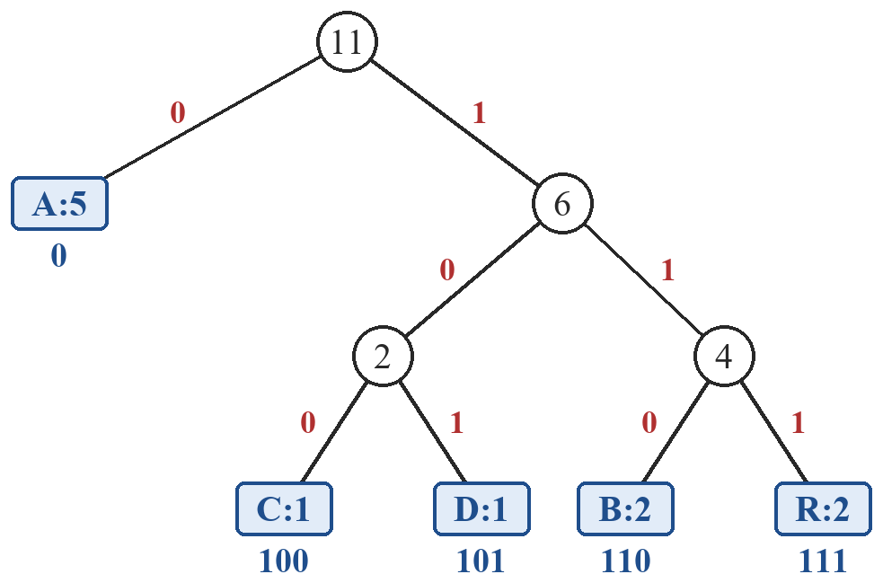

# Huffman Text Compression

A small Python program that compresses and decompresses **text files** with **Huffman coding**.
It was written for the midterm assignment of the *Advanced Algorithms* course:

> Use Huffman Codes and Data Compression to compress one type of data (text, audio or image),
> present the algorithm, compute O, Ω, Θ and evaluate the complexity.

This project chooses **text files**. The program works on Unicode characters (files are read as UTF-8), so Vietnamese text with diacritics is supported. Compression is **lossless**: the decompressed file is byte-for-byte identical to the original. No compression library (zlib, gzip, ...) is used.

## Features

- Read a `.txt` file (UTF-8)
- Count the frequency of each character
- Build the Huffman tree with a **min-heap** (`heapq`)
- Create the Huffman code table (left = `0`, right = `1`)
- Compress: encode the text and pack the bits into bytes (`.huf` file)
- Decompress: rebuild the tree and decode the bits
- Compare file sizes (Compression Ratio, Space Saving)
- Check that the restored file is exactly the same as the original

## How it works


The `.huf` file stores a small header (the frequency table and the number of padding bits) followed by the encoded data:

```
[4 bytes: header length] [header: JSON {"padding": p, "freq": {...}}] [encoded data]
```

The decompressor uses the frequency table to rebuild exactly the same tree.

## Huffman tree example

For the string `ABRACADABRA` (file `data/example.txt`), the frequencies are A = 5, B = 2, R = 2, C = 1, D = 1.
The two smallest nodes are merged again and again: C+D → 2, B+R → 4, (CD)+(BR) → 6, A+(CDBR) → 11.



| Char | Frequency | Code | Bits |
|:---:|---:|:---:|---:|
| A | 5 | `0` | 5 |
| B | 2 | `110` | 6 |
| R | 2 | `111` | 6 |
| C | 1 | `100` | 3 |
| D | 1 | `101` | 3 |
| **Total** | **11** | | **23** |

The text needs 23 bits instead of 11 × 8 = 88 bits in ASCII.

## Technologies

- Python 3.8+ (standard library only: `heapq`, `json`)

## Project structure

```
huffman-text-compression/
├── huffman.py          # Huffman algorithm: frequency, tree, codes, compress, decompress
├── main.py             # Command-line interface
├── data/
│   ├── example.txt     # "ABRACADABRA"
│   ├── sample_vi.txt   # Vietnamese sample text
│   └── sample_en.txt   # English sample text
└── docs/
    └── huffman_tree.png
```

## Installation and usage

```bash
git clone https://github.com/<your-username>/huffman-text-compression.git
cd huffman-text-compression
```

No extra packages are needed.

```bash
# Compress
python main.py compress data/sample_vi.txt data/sample_vi.huf

# Decompress
python main.py decompress data/sample_vi.huf data/sample_vi_restored.txt

# Demo: compress -> decompress -> compare sizes -> check the result
python main.py demo data/sample_vi.txt
```

Example output (the program prints its messages in Vietnamese):

```
$ python main.py demo data/sample_vi.txt
=== 1. NÉN ===
Đã nén 'data/sample_vi.txt' -> 'data/sample_vi.huf' (0.001 giây)
Số ký tự n = 2,621, số ký tự khác nhau k = 121
Độ dài mã trung bình: 5.060 bit/ký tự

Bảng mã Huffman (10 ký tự xuất hiện nhiều nhất):
  Ký tự     Tần suất  Mã
  ' '            576  01
  'n'            244  1111
  'h'            178  1011
  't'            135  0011
  'i'            122  0000
  ...

Dung lượng file gốc :      3,490 byte
Dung lượng file nén :      2,579 byte  (header 921 + dữ liệu 1,658)
Compression Ratio   :       1.35  (file gốc / file nén)
Space Saving        :     26.10 %

=== 2. GIẢI NÉN ===
Đã giải nén 'data/sample_vi.huf' -> 'data/sample_vi_restored.txt' (2,621 ký tự, 0.001 giây)

=== 3. KIỂM TRA ===
Khôi phục chính xác: CÓ
```

## Experimental results

- **Compression Ratio (CR)** = original size / compressed size (CR > 1 means the file got smaller)
- **Space Saving (SS)** = (1 − compressed size / original size) × 100%

Results measured on my machine with `python main.py demo <file>`:

| File | Characters (n) | Distinct (k) | Original | Compressed | CR | SS | Restored |
|---|---:|---:|---:|---:|---:|---:|:---:|
| `example.txt` | 11 | 5 | 11 B | 59 B | 0.19 | −436.36 % | yes |
| `sample_en.txt` | 1,833 | 48 | 1,833 B | 1,362 B | 1.35 | 25.70 % | yes |
| `sample_vi.txt` | 2,621 | 121 | 3,490 B | 2,579 B | 1.35 | 26.10 % | yes |
| `sample_vi.txt` × 100 | 262,100 | 121 | 349,000 B | 166,938 B | 2.09 | 52.17 % | yes |

The last row uses a file made by repeating `sample_vi.txt` 100 times:

```bash
python -c "t=open('data/sample_vi.txt',encoding='utf-8',newline='').read(); open('data/large_vi.txt','w',encoding='utf-8',newline='').write(t*100)"
python main.py demo data/large_vi.txt
```

- Small files can get bigger, because the header (frequency table) is larger than the saved space. The header depends only on k, so it becomes negligible for large files.
- Running time grows linearly: repeating `sample_vi.txt` 50, 100 and 200 times gave compression times of 0.019 s, 0.038 s and 0.076 s, and decompression times of 0.043 s, 0.085 s and 0.178 s. Exact times depend on the machine.

## Complexity

With `n` = number of characters, `k` = number of distinct characters and `L` = average code length in bits:

- Building the Huffman tree: **O(k log k)**
- Whole program: **O(n·L + k log k)**, which gives **O(n log k)** (worst case) and **Ω(n)** (every character must be read). When k is bounded (a fixed alphabet), this becomes **Θ(n)**: linear in the text length.
- Memory: **O(n·L + k)**, which is **Θ(n)** for a fixed alphabet.

See the report for the full analysis.
